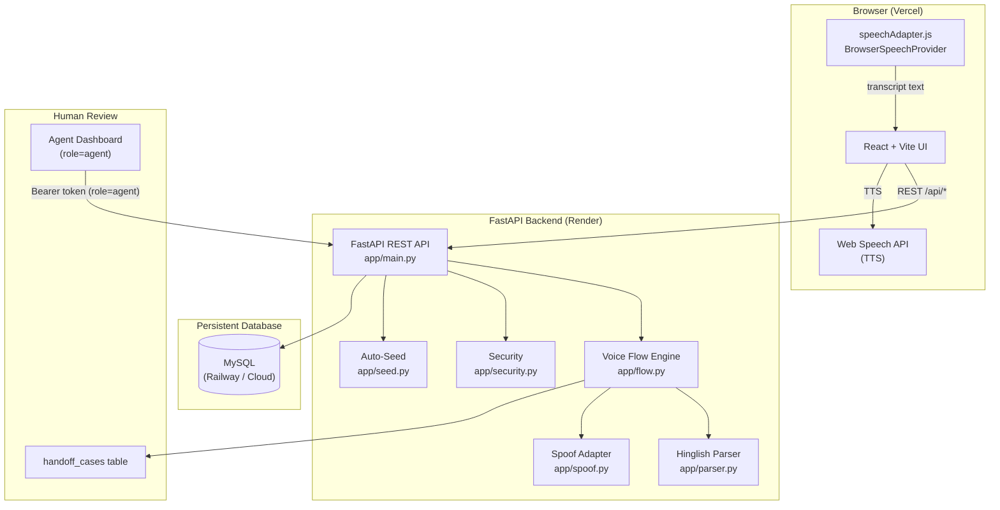
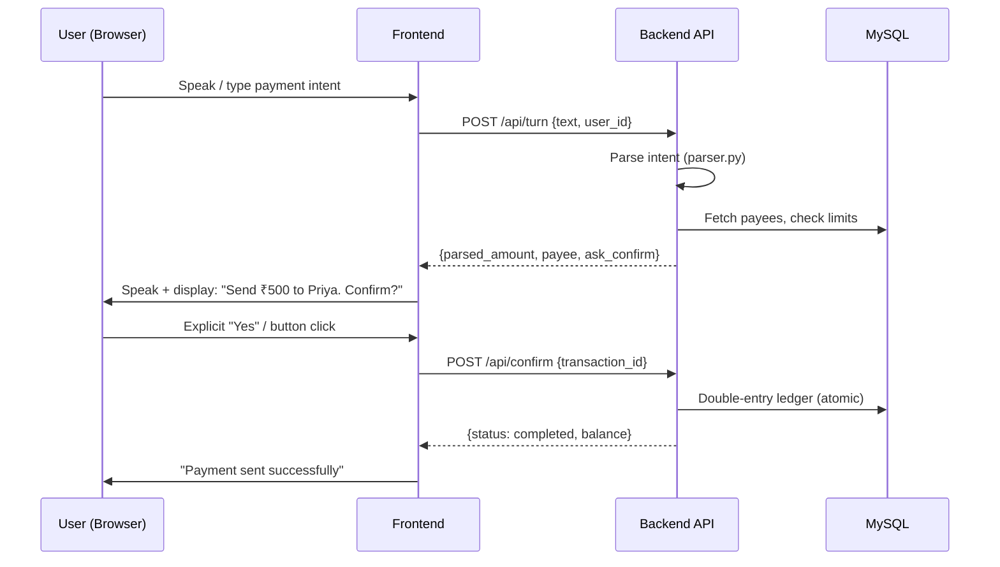

# Saathi Voice Banking — Design Note

## Architecture Overview

Saathi is a full-stack voice-enabled banking demo. The system is split into a React frontend (Vercel) and a FastAPI backend (Render) backed by a persistent MySQL database.

## Components

| Layer | Technology | Purpose |
|-------|-----------|---------|
| Frontend | React 18 + Vite | Customer banking UI + agent dashboard |
| Speech | Web Speech API | STT (browser) + TTS (browser) |
| Backend | FastAPI 0.115 | REST API, business logic, auth |
| ORM | SQLAlchemy 2.0 | DB-agnostic models |
| Database | MySQL (Railway) | Persistent accounts, ledger, audit |
| Auth | JWT HS256 (python-jose) | Bearer tokens, role-based access |
| PIN | bcrypt (passlib) | Hashed PIN storage |
| Parser | Custom NLP | Hinglish/English amount parsing |
| Spoof | Pluggable adapter | Disabled → HeuristicTest → RemoteHttp |

## Primary Demo Data Flow

## Hosting & Deployment

| Service | Provider | URL |
|---------|---------|-----|
| Frontend | Vercel | *(pending Vercel deployment)* |
| Backend | Render (Free) | https://saathi-payment-project-2.onrender.com *(Verified Live)* |
| Database | TiDB Cloud | Cloud-hosted persistent MySQL (AWS Tokyo) |

> [!NOTE]
> Render free tier services spin down after inactivity. Expect a ~30s cold start on first request after idle.

## Key Design Decisions

- **SQLite fallback**: If `DATABASE_URL` is not set, the backend falls back to `sqlite:///./voice_banking.db` — used only for local dev and tests.
- **Auto-seed**: On startup, if `users` table is empty, seed runs automatically. Safe for production; does not reset existing data.
- **Double-entry ledger**: All transfers atomically create two `ledger_entries` (debit source, credit destination) plus a `payments` record. On failure, the entire transaction rolls back.
- **Idempotency**: Each payment has an `idempotency_key`; duplicate submissions return the existing result.
- **Pluggable spoof detection**: `SPOOF_PROVIDER=disabled` (default) → all liveness checks fail-closed and route to human handoff. Switch to `heuristic` or `remote_http` without code changes.
